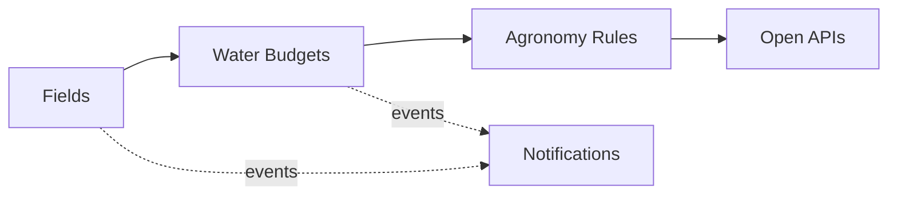

# Domain Model and Bounded Contexts

Ubiquitous language and context design (view VP-4). Domain-standard concepts are mapped
normatively in `../domain/domain-standards.md` (CR-5).

## Ubiquitous language (selected terms)

| Term | Meaning |
|---|---|
| **Field** | A managed land unit with one crop per season |
| **Water budget** | The seasonal irrigation allowance of a field, in water units |
| **Water use** | One irrigation draw against a field's water budget |
| **Agronomy rule** | A decision rule binding a crop to water and weather envelopes |
| **Machine** | A tractor, harvester, drone or pump in the fleet registry |
| **Crop health score** | A transparent 0-100 risk score from field signals |

## Bounded contexts and invariants

### Fields — `field-service`
Field registry: land units, crops and seasons (ADAPT-aligned shapes). Lifecycle: `ACTIVE` → transitions
fallow, reactivate. Farm and field data is commercially sensitive: operator identifiers are internal UUIDs, no personal data is required by any contract, and recipients are never logged.

### Water Budgets — `irrigation-service`
Seasonal water budgets per field and the irrigation draws against them. **Invariant (ADR-0004): the seasonal water budget of a field is never overdrawn — an irrigation draw that exceeds the remaining budget is rejected (422) and records nothing.** Consumption records are
append-only evidence; a rejected operation records nothing.

### Agronomy Rules — `agronomy-rules-service`
Decision rules binding crops to water and weather envelopes, with reasoned decisions. Only ACTIVE rules decide; evaluation order is by priority; every decision
is ALLOWED / DEGRADED / DENIED with the matched rule and a human-readable reason.

### Machines — `machine-service`
Fleet registry: tractors, harvesters, drones and pumps.

### Notifications — `notification-service`
Delivery trail for audit; recipients are never logged.

## Context map

